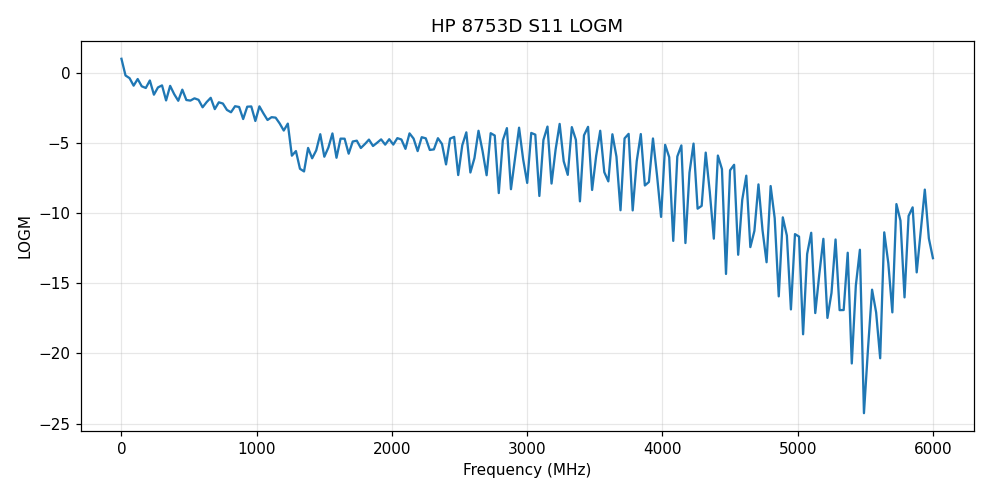

# HP 8753D

Scripts en Python para leer trazas del analizador de redes HP 8753D por GPIB, con el adaptador USB [xyphro UsbGpib](https://github.com/xyphro/UsbGpib) y `pyvisa`.



## Instalación

```bash
brew install libusb            # macOS (Debian/Ubuntu: apt install libusb-1.0-0)
pip install -r requirements.txt
```

En Windows se usa NI-VISA en vez de `pyvisa-py`.

El analizador tiene que estar en modo TALKER/LISTENER, con dirección GPIB 16. Para comprobar la conexión:

```bash
python3 hp8753d_connect.py
```

## Uso de `get_trace.py`

```bash
python3 get_trace.py                         # canal activo -> CSV
python3 get_trace.py --chan 1 2              # ambos canales
python3 get_trace.py --sweep                 # hace un barrido único antes de leer (queda en HOLD)
python3 get_trace.py --plot                  # además guarda un PNG como el de arriba
python3 get_trace.py --s1p                   # además guarda los datos corregidos en Touchstone (.s1p)
python3 get_trace.py --chan 1 --format SMIC  # carta de Smith: CSV con R/X + SVG tamaño carta
```

| Opción | Descripción |
|---|---|
| `--resource` | Recurso VISA (por defecto, el del adaptador xyphro) |
| `--chan 1 2` | Canal o canales a leer (por defecto, el activo) |
| `--format` | Cambia el formato de pantalla antes de leer: `LOGM`, `PHAS`, `DELA`, `SMIC`, `POLA`, `LINM`, `SWR`, `REAL`, `IMAG` |
| `--sweep` | Hace un barrido único antes de leer |
| `--s1p` | Guarda también los datos corregidos (real/imag) en `.s1p` |
| `--plot` | Guarda también un PNG (requiere matplotlib) |
| `--outdir` | Carpeta de salida (por defecto `vna_traces/`) |

Los archivos se nombran `trace_<fecha>_ch<canal>_<parámetro>_<formato>.*`. El CSV tiene las columnas `freq_Hz,val1,val2`, donde `val1` es el valor que se ve en pantalla (por ejemplo dB en `LOGM`). En formato `SMIC` las columnas son `gamma_re,gamma_im,R_ohm,X_ohm`.

Si hay timeouts de GPIB, desconecta y vuelve a conectar el adaptador. Ojo: con `pyvisa-py` 0.8.x las lecturas de traza fallan, por eso `requirements.txt` fija la versión 0.7.2.
